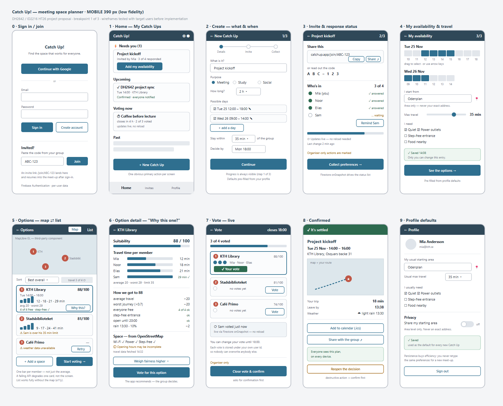
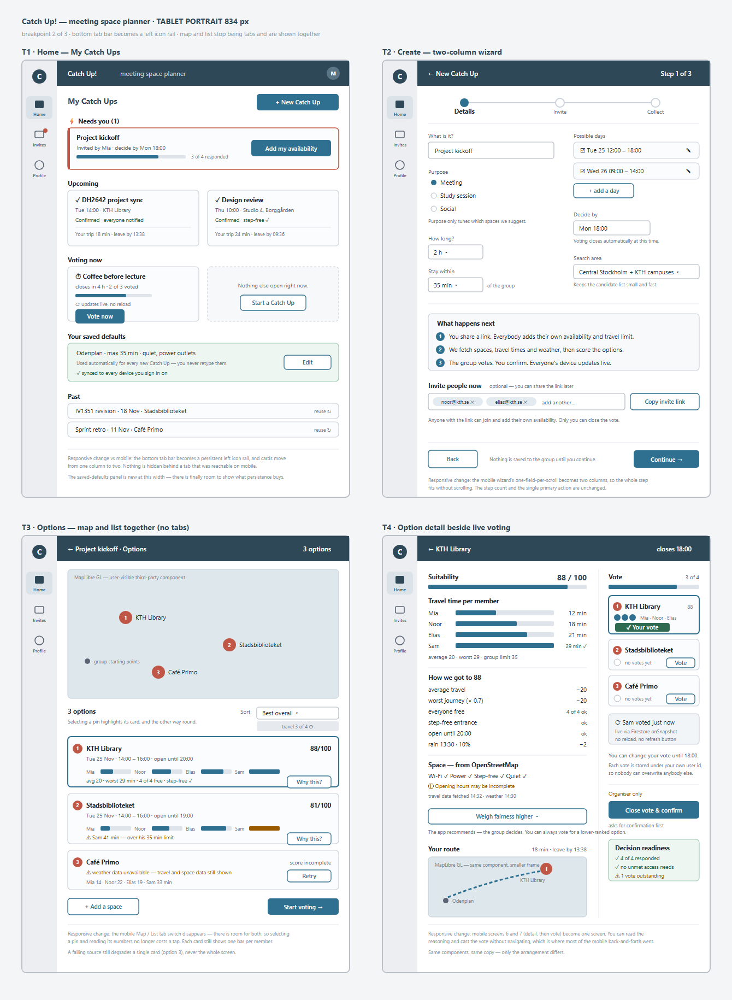
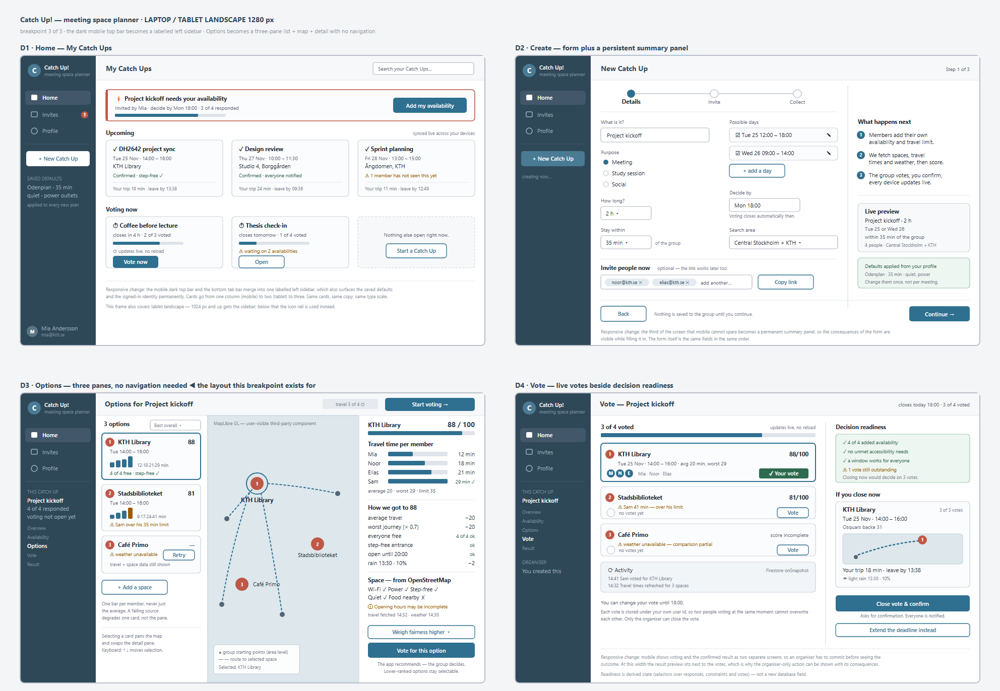

# Catch Up! — Project Proposal

**Course:** DH2642 / ID2216 HT26 — Interaction Programming and the Dynamic Web
**Deliverable:** Project proposal
**Date:** 2026-11-20

> Working title: **Catch Up!** — a *meeting space planner*.
> Alternatives the group considered: *Collab*, *Collaboratory*.
> The name describes what the app does for people — getting a group **together** — rather than
> describing a document it produces. The app is **not study-specific**: a study session is one
> purpose among several, alongside project meetings, supervisor check-ins and purely social
> meet-ups. The thing being planned is a *meeting and a space*, not a study plan.

---

## 1. Group members

| # | Name | Canvas ID | Primary role |
|---|---|---|---|
| 1 | *TBD* | *TBD* | Application state & architecture (store, actions, selectors) |
| 2 | *TBD* | *TBD* | External API sources (transport, places, weather) |
| 3 | *TBD* | *TBD* | Authentication, Firestore persistence, live sync |
| 4 | *TBD* | *TBD* | Interaction design, views, accessibility, user studies |

Roles are a *primary* responsibility split, not four separate projects. Every member reviews code
outside their own area and must be able to explain the full data flow at examination. Work amounts
and roles will be documented in the individual self-reflections.

> **Action before submission:** fill in the four names and Canvas IDs, and confirm the group is a
> **Project group** in Canvas (not a Lab group).

---

## 2. Name of the app

**Catch Up!** — a meeting space planner for groups.

Tagline: *Find the space that works for everyone — and see why.*

---

## 3. Short description

**Catch Up!** is a responsive, mobile-first collaborative web app that helps a small group of KTH
students agree on **when and where to meet in person**. Any purpose qualifies: a project kickoff, a
design review, a supervisor check-in, a study session, or coffee before a lecture. What the app
plans is the **meeting and the space**, so the purpose only tunes which spaces get suggested.

Today this happens in a group chat: everyone posts when they are free, somebody proposes a place,
two people check travel times in another app, somebody else checks whether the library is open, and
the final decision is buried 40 messages up. The information is spread across five apps and the
decision is impossible to evaluate.

In Catch Up! each member enters their own availability, an approximate starting point, how far they
are willing to travel, and what they need from a space (quiet, power outlets, step-free access,
food nearby). The app combines that with live external data — candidate spaces, public transport
travel times per person, and weather — and produces a short list of **explainable options**. Each
option shows the group what it actually costs *every* member, not just the average. The group votes,
the organiser confirms, and the decision syncs in real time to everyone's device.

**The added value is the group decision, made transparent.** Catch Up! does not try to be a better
map, a better calendar, or a better place search. It is the layer on top of them that turns
individual constraints plus external data into a fair choice the group can see the reasoning behind.

### What makes it different from existing tools

| Existing tool | What it does | What it doesn't do |
|---|---|---|
| When2meet / Doodle | Finds a common *time* | Ignores *where*, and travel cost per person |
| Google Maps | Routes to a space you already picked | Doesn't pick a space for a *group* |
| Room booking systems | Reserve a known room | No group constraints, no travel cost, no choosing |
| Group chat | Negotiation | No shared state, no comparison, no fairness |

Catch Up! sits in the gap: time **and** place **and** per-person fairness **and** an audit trail of
why the group chose what it chose.

### Example scenario

Four students need a two-hour kickoff meeting for a course project. They are free at different times
and travel from Flemingsberg, Odenplan, Kista, and Lappis. One uses a wheelchair and needs step-free
access; another refuses to travel more than 35 minutes. Catch Up! evaluates KTH Library, Stockholm
Public Library, and two cafés across three time windows, and reports:

```
Tue 14:00–16:00 · KTH Library                     Suitability 88 / 100
Travel:  12 · 18 · 21 · 29 min      (avg 20, worst 29)
Everyone free:  4 of 4              Step-free: yes
Open until 20:00                    Rain at 13:30: 10%
                                                     [ Why this one? ]
```

Everyone votes from their own phone, the votes appear live, and the confirmed plan persists so that
re-opening the app on a laptop shows the same result.

---

## 4. Frameworks and technologies

| Concern | Technology | Why |
|---|---|---|
| UI framework | **React 18** (JSX, function components) | Course-supported, matches the lab setup |
| Build tool | **Vite** | Course-supported minimal setup (4 files) |
| Application state | **Redux Toolkit** + **react-redux** | Explicit actions and side effects; needed for the A criterion "state manager with actions, all state side effects go through the state manager" |
| View ↔ state binding | `connect()` **mappings** where practical | Targets the A-plus "framework-independent Redux mappings instead of custom hooks" |
| Navigation | **react-router-dom** | Invite links (`/join/:code`) and deep links to a meet-up; route treated as application state |
| Authentication | **Firebase Authentication** (email/password + Google) | Per-user persistence, course-supported |
| Persistence | **Cloud Firestore** (`onSnapshot` listeners) | Live multi-device updates, per-user document ownership, security rules |
| Map (user-visible 3rd-party component) | **MapLibre GL JS** via `react-map-gl`, or **React Leaflet** | Satisfies "at least one user-visible component written by others" |
| Styling | CSS Modules, mobile-first, three breakpoints (`<600`, `600–1023`, `>=1024 px`) | Responsive/mobile-first is part of the A criterion when it fits the use case. Breakpoint is published into application state so views contain no media queries |
| Deployment | Course-supported deployment, from week 1 | Early deploy so the course team can troubleshoot the live app |

Language: **JavaScript (JSX)**, as in the labs. We will not add a dependency unless it has a clear
job and a license we have read. Any code reused from the lab (e.g. `resolvePromise`, `dishSource`
patterns, `suspenseView`) will carry a comment acknowledging that it came from the course.

### Architecture

Four strictly separated concerns, visible in the folder structure *and* in the data flow:

```
src/
├── api/            transitSource.js  placeSource.js  weatherSource.js     (external data only)
├── persistence/    firebaseConfig.js  authPersistence.js  meetupPersistence.js
├── model/          store.js  slices/{user,meetup,participant,option,vote,request}.js  selectors.js
├── presenters/     HomePresenter  CreatePresenter  AvailabilityPresenter
│                   OptionsPresenter  OptionDetailPresenter  VotePresenter  ResultPresenter
├── views/          HomeView  CreateView  AvailabilityView  OptionsMapView
│                   OptionsListView  OptionDetailView  VoteView  ResultView
├── components/     MapCanvas  TravelBars  LoadingStatus  ErrorPanel  NavBar
└── index.jsx
```

Rules we will enforce in code review:

- Views receive everything through props and report user actions through callback props. A view never
  imports the store, Firebase, or an API module. One module per view, one role per view.
- Presenters select state, shape props, dispatch actions, and choose between suspense / error /
  empty / content views. Nothing else — no fetching, no persistence, no CSS, no component state.
- Persistence is reached only through Firestore side effects triggered by state changes, never from
  a view or a presenter event handler.
- Firestore **security rules** enforce membership and ownership. Hiding a button is not a permission.

---

## 5. APIs that will be used

Three external sources are mashed up, plus Firebase for auth and persistence.

| # | API | Used for | Key / access | Risk |
|---|---|---|---|---|
| 1 | **Trafiklab Resrobot v2.1** (`/trip`) — Swedish public transport | Door-to-door travel time and itinerary for each participant to each candidate space | Free key, requires registration at trafiklab.se | Browser/CORS access and rate limits must be tested in week 1; fall back to the **course proxy**. Secondary candidate: SL Journey Planner |
| 2 | **OpenStreetMap** — Overpass API for space discovery + **Nominatim** (or Photon) for geocoding the participants' starting points | Candidate spaces (libraries, campus buildings, cafés) with coordinates, opening hours, `wheelchair`, `internet_access` tags | No key; usage policy requires an identifying User-Agent and low request rate | Data completeness varies. We cache results in Firestore, respect the rate limit, and let users add a space manually |
| 3 | **Open-Meteo** forecast API | Weather at the proposed meeting time, to flag "20 min walk in heavy rain" | No key, CORS-friendly | Low |
| 4 | **MapLibre GL JS** + an OSM-based raster/vector tile source | The interactive map component | Tile provider terms to be confirmed | Low |
| 5 | **Firebase Auth + Cloud Firestore** | Authentication and live per-user persistence | Free tier | Low |

Each API gets its own source module exporting plain promise-returning functions that **normalise**
the response into our own internal shape, so the model never sees a provider's JSON. Every request
is tracked in application state as `idle | pending | fulfilled | rejected`, which drives visible
status and retry controls, and lets the rest of the UI stay usable while a request is in flight.

Budget note: the course covers API costs up to 200 SEK against a receipt. Our current selection is
free; if we need a paid tier we will contact `dh2642-ta@eecs.kth.se` first.

> **Action in week 1 (de-risking):** register the Trafiklab key and prove a browser call works
> (direct or via the proxy) *before* the architecture commits to it. If transport data turns out to
> be unusable, the fallback is a distance/walk-time model from OSM data, keeping the same UI.

---

## 6. Data the app works with

### 6.1 Data coming from external APIs

| Data | Source | Notes |
|---|---|---|
| Space candidates: name, coordinates, category | Overpass (OSM) | Restricted to central Stockholm + KTH campuses initially |
| Space attributes: opening hours, `wheelchair`, `internet_access`, `power_supply` | Overpass (OSM) | Shown with a "from OpenStreetMap, may be incomplete" marker — we never claim it is verified |
| Geocoding: approximate coordinates for a typed starting point ("Odenplan") | Nominatim / Photon | Area-level only, by design (see privacy) |
| Travel time + itinerary legs per participant per space per time slot | Resrobot | Cached per (origin, space, slot) with a timestamp |
| Weather forecast: precipitation, temperature, wind at the proposed time | Open-Meteo | Per space coordinates and meeting time |
| Map tiles | MapLibre tile source | Rendered by the third-party map component |

### 6.2 Data that is specific to our app (Firestore)

```text
users/{uid}
    displayName, photoURL
    defaults: { startingArea, maxTravelMinutes, spacePreferences[], accessibilityNeeds[] }

meetups/{meetupId}
    title            e.g. "Project kickoff"
    purpose          meeting | study | social | other
    organizerId, inviteCode, status (collecting | voting | confirmed | cancelled)
    candidateWindows[]   proposed date/time intervals
    durationMinutes, decisionDeadline
    areaBounds?, confirmedOptionId?

meetups/{meetupId}/participants/{uid}
    role (organizer | member), responseStatus, joinedAt
    startingArea, maxTravelMinutes, accessibilityNeeds[], spacePreferences[], budgetLimit?

meetups/{meetupId}/availability/{uid}
    intervals[], updatedAt

meetups/{meetupId}/options/{optionId}
    space  { name, coords, source, sourceId, attributes }     cached from API
    proposedWindow
    travel { uid -> minutes }                                  cached from API
    weather { ... }                                            cached from API
    scoreComponents { meanTravel, maxTravel, unavailable, accessibilityPenalty, openingPenalty, weatherPenalty }
    externalDataFetchedAt

meetups/{meetupId}/votes/{uid}
    optionId[], updatedAt

meetups/{meetupId}/activity/{eventId}
    type, actorId, createdAt, summary
```

Two deliberate design decisions:

1. **One document per user per concern.** Availability, preferences, and votes are keyed by `uid`, so
   two people editing at the same time cannot overwrite each other, and Firestore rules can say
   "you may only write your own document". This is how we handle the *collaborative conflict
   management* criterion rather than hoping it does not happen.
2. **External data is cached into the option document with a timestamp.** The group sees consistent
   numbers, the UI can show "travel times from 14:32", and a dead API does not blank the screen.

### 6.3 Data derived in application state (not persisted)

Computed by selectors, so it is reproducible and testable: availability overlap per time window,
constraint satisfaction per participant, the suitability score and its ranking, and the
human-readable explanation behind each option.

### 6.4 The scoring model (transparent on purpose)

```text
cost(option) = meanTravelMinutes
             + 0.7 × maxTravelMinutes          ← punishes "fine on average, terrible for Anna"
             + 25 × participantsUnavailable
             + accessibilityPenalty             ← hard requirement unmet
             + openingHoursPenalty
             + weatherPenalty

suitability  = 100 scaled against the best and worst option in the set
```

A simple weighted sum beats an opaque recommender here, because the UI can show every term. The
weights are **design assumptions to be tested with users**, not facts. A "Why this one?" control
expands the breakdown, and the group is always free to pick a lower-ranked option — the app
recommends, the group decides.

### 6.5 Privacy

Starting points are stored and shared at **area** granularity (a stop or neighbourhood), never a
home address, and are not shown to other members unless the user opts in. Users are told what is
collected and why. Same principle in the user study: minimum data, explicit consent, deletion after
the course.

---

## 7. Mock-up of the screens

Low-fidelity, mobile-first (390 px primary). These wireframes are the shared reference for the group and
the artefact we will put in front of target users **before** building the real UI. A paper/Figma
version will be tested first and the findings documented in the final submission.

The app is **responsive across three breakpoints**. The mobile layout is the primary design; the two
larger layouts rearrange the same components without adding new ones or changing the type scale.
Full rules in `CatchUp_Responsive_Spec.md`.

| Sheet | Breakpoint | Frame | Screens |
|---|---|---|---|
|  | Mobile, `< 600 px` | 390 × 844 | 10 |
|  | Tablet portrait, `600–1023 px` | 834 × 1112 | 4 |
|  | Laptop / tablet landscape, `≥ 1024 px` | 1280 × 800 | 4 |

Editable sources are in `mockups/` as SVG; Figma-import copies are in `mockups/figma/`.

The three biggest layout changes:

- **Navigation** — bottom tab bar (mobile) → left icon rail (tablet portrait) → labelled left
  sidebar that absorbs the brand bar (laptop).
- **Options** — map and list as two tabs (mobile) → both visible stacked (tablet portrait) → three
  panes of list + map + "Why this one?" with no navigation at all (laptop).
- **Detail and voting** — two separate screens (mobile) → one screen (tablet portrait) → votes
  beside a live result preview, so the organiser sees the consequence of closing the vote (laptop).

Tablet **landscape** uses the laptop layout: at 1024 px and up there is room for the sidebar and the
three-pane view, so it needs no layout of its own.

The ASCII wireframes below are the mobile screens in text form, so they stay readable and diffable
in the repository.

### Screen map

```text
                        ┌──────────────┐
                        │ 0 Sign in /  │
                        │   Join link  │
                        └──────┬───────┘
                               ▼
      ┌────────────────── 1 Home: My Catch Ups ──────────────────┐
      │   upcoming · invitations · past            [+ New]       │
      └──┬───────────────────────────────────────────────┬───────┘
         ▼                                               ▼
   2 Create (What & When)                          9 Profile defaults
         ▼
   3 Invite & response status
         ▼
   4 My availability & travel limits
         ▼
   5 Options  ── map ⇄ list ──►  6 Option detail / Why this one?
         ▼
   7 Vote (live)
         ▼
   8 Confirmed result
```

### 0 · Sign in / join

```text
┌──────────────────────────────┐
│          Catch Up!           │
│ Find the space that works    │
│                              │
│  [ Continue with Google   ]  │
│  ──────── or ──────────────  │
│  Email    [______________]   │
│  Password [______________]   │
│  [ Sign in ]  [ Create ]     │
│                              │
│  Invited?  Paste your code   │
│  [ ABC-123 ] [ Join ]        │
└──────────────────────────────┘
```

An invite link `/join/ABC-123` lands here and resumes into the meet-up after sign-in, so a newcomer
never has to hunt for the session.

### 1 · Home — My Catch Ups

```text
┌──────────────────────────────┐
│ Catch Up!              ⚙ 👤 │
├──────────────────────────────┤
│ ⚡ Needs you (1)             │
│ ┌──────────────────────────┐ │
│ │ Project kickoff         │ │
│ │ Invited by Mia · 3 of 4  │ │
│ │ responded                │ │
│ │ [ Add my availability ]  │ │
│ └──────────────────────────┘ │
│                              │
│ Upcoming                     │
│ ┌──────────────────────────┐ │
│ │ ✓ DH2642 project sync    │ │
│ │ Tue 14:00 · KTH Library  │ │
│ │ Confirmed                │ │
│ └──────────────────────────┘ │
│                              │
│ Voting now                   │
│ ┌──────────────────────────┐ │
│ │ ⏱ Coffee before lecture  │ │
│ │ closes in 4 h · 2 votes  │ │
│ └──────────────────────────┘ │
│                              │
│      [  + New Catch Up  ]    │
├──────────────────────────────┤
│  Home   Invites   Profile    │
└──────────────────────────────┘
```

Every screen has one obvious primary action, and empty states explain the next step instead of
showing a blank list.

### 2 · Create — what & when

```text
┌──────────────────────────────┐
│ ← New Catch Up          1/3  │
│ ●──────○──────○              │
│ Details  Invite  Collect     │
├──────────────────────────────┤
│ What is it?                  │
│ [ Project kickoff________ ] │
│ Purpose  (•)Meeting ( )Study │
│          ( )Social           │
│                              │
│ How long?   [ 2 h  ▾ ]       │
│                              │
│ Possible days                │
│ [✓] Tue 25  12:00 – 18:00 ✎  │
│ [✓] Wed 26  09:00 – 14:00 ✎  │
│ [ + add a day ]              │
│                              │
│ Stay within  [ 35 min ▾ ] of │
│ the group                    │
│ Decide by   [ Mon 18:00  ]   │
│                              │
│        [  Continue  ]        │
└──────────────────────────────┘
```

### 3 · Invite & response status

```text
┌──────────────────────────────┐
│ ← Project kickoff      2/3  │
├──────────────────────────────┤
│ Share this                   │
│ ┌──────────────────────────┐ │
│ │ catchup.app/join/ABC-123 │ │
│ │          [ Copy ]  [ ⤴ ] │ │
│ └──────────────────────────┘ │
│ Code  A B C - 1 2 3          │
│                              │
│ Who's in            3 of 4   │
│ ● Mia (you)   ✓ answered     │
│ ● Noor        ✓ answered     │
│ ● Elias       ✓ answered     │
│ ○ Sam         … waiting      │
│               [ Remind Sam ] │
│                              │
│ Updates live — no reload     │
│ Last change 2 min ago        │
│                              │
│   [ Collect preferences → ]  │
└──────────────────────────────┘
```

### 4 · My availability & travel limits

```text
┌──────────────────────────────┐
│ ← My availability       3/3  │
├──────────────────────────────┤
│ Tue 25 Nov                   │
│  10 11 12 13 14 15 16 17 18  │
│  ░░ ░░ ██ ██ ██ ██ ░░ ░░ ░░  │
│        └ drag to select ┘    │
│                              │
│ Wed 26 Nov                   │
│  09 10 11 12 13 14           │
│  ██ ██ ██ ░░ ░░ ░░           │
│                              │
│ I start from                 │
│ [ Odenplan____________ ] 📍  │
│ Area only — never your       │
│ exact address.               │
│                              │
│ Max travel   [——————●——] 35m │
│                              │
│ I need                       │
│ [✓] Quiet  [✓] Power outlets │
│ [ ] Step-free entrance       │
│ [ ] Food nearby              │
│                              │
│ ✓ Saved 14:08   Only you can │
│   change this.               │
│                              │
│    [ See the options → ]     │
└──────────────────────────────┘
```

Reuses the user's profile defaults so nobody retypes the same preferences for every meet-up — this
is where persistence directly buys efficiency.

### 5 · Options — map ⇄ list

```text
┌──────────────────────────────┐
│ ← Options         [Map|List] │
├──────────────────────────────┤
│ ░░░░░░░░ MapLibre ░░░░░░░░░░ │
│ ░░  ①KTH   ░░░░░░░░░░░░░░░░ │
│ ░░░░░░░░░  ②Stadsbibl ░░░░░ │
│ ░░░░░░ ③Café ░░░░░░░░░░░░░░ │
├──────────────────────────────┤
│ Sort [ Best overall ▾ ]      │
│ ░░ fetching travel 3 of 4 ░░ │
│                              │
│ ┌──────────────────────────┐ │
│ │ ① KTH Library      88/100│ │
│ │ Tue 14:00 – 16:00        │ │
│ │ ▁▃▃▅  12·18·21·29 min    │ │
│ │ avg 20 · worst 29        │ │
│ │ 4 of 4 free · step-free  │ │
│ │           [ Why this? ]  │ │
│ └──────────────────────────┘ │
│ ┌──────────────────────────┐ │
│ │ ② Stadsbiblioteket 81/100│ │
│ │ ▁▃▅▇  9·17·24·41 min     │ │
│ │ ⚠ Sam over 35 min limit  │ │
│ └──────────────────────────┘ │
│ ┌──────────────────────────┐ │
│ │ ③ Café Primo       —     │ │
│ │ ⚠ weather data missing   │ │
│ │              [ Retry ]   │ │
│ └──────────────────────────┘ │
│                              │
│      [ + Add a space ]       │
│      [ Start voting → ]      │
└──────────────────────────────┘
```

Note the four small bars on each card: that is **every member's** journey, not just the average.
Partial failure degrades one card, it does not replace the screen with an error. The map and list are
two tabs on mobile and side by side on desktop, and the list is fully usable without the map for
keyboard and screen-reader users.

### 6 · Option detail — "Why this one?"

```text
┌──────────────────────────────┐
│ ← KTH Library                │
├──────────────────────────────┤
│ Suitability      88 / 100    │
│                              │
│ Travel time                  │
│  Mia    ▇▇▇░░░░░░░  12 min   │
│  Noor   ▇▇▇▇▇░░░░░  18 min   │
│  Elias  ▇▇▇▇▇▇░░░░  21 min   │
│  Sam    ▇▇▇▇▇▇▇▇░░  29 min ✓ │
│  average 20 · worst 29       │
│                              │
│ How we got to 88             │
│  average travel      −20     │
│  worst journey       −20     │
│  everyone free       4/4  ok │
│  step-free           ok      │
│  open until 20:00    ok      │
│  rain 13:30 · 10%    −2      │
│                              │
│ Space (OpenStreetMap)        │
│  Wi-Fi ✓  Power ✓            │
│  Step-free ✓                 │
│  Hours may be incomplete ⓘ   │
│                              │
│ [ Weigh fairness higher ▾ ]  │
│                              │
│   [ Vote for this option ]   │
└──────────────────────────────┘
```

### 7 · Vote — live

```text
┌──────────────────────────────┐
│ ← Vote      closes 18:00 ⏱  │
├──────────────────────────────┤
│ 3 of 4 voted                 │
│                              │
│ ① KTH Library                │
│    ●●●  Mia Noor Elias       │
│    [ ✓ Your vote ]           │
│                              │
│ ② Stadsbiblioteket           │
│    ○                         │
│    [ Vote ]                  │
│                              │
│ ③ Café Primo                 │
│    ○                         │
│    [ Vote ]                  │
│                              │
│ ⟳ Sam voted just now         │
│   (live, no reload)          │
│                              │
│ You can change your vote     │
│ until 18:00.                 │
│                              │
│ Organiser only:              │
│ [ Close vote & confirm ]     │
└──────────────────────────────┘
```

### 8 · Confirmed

```text
┌──────────────────────────────┐
│ ✓ It's settled               │
├──────────────────────────────┤
│ Project kickoff             │
│ Tue 25 Nov · 14:00 – 16:00   │
│ KTH Library, Osquars backe   │
│                              │
│ ░░░░ map + your route ░░░░░  │
│                              │
│ Your trip   18 min           │
│ Leave by    13:38            │
│ 🌧 light rain at 13:30       │
│                              │
│ [ Add to calendar (.ics) ]   │
│ [ Share with the group  ⤴ ]  │
│                              │
│ Everyone sees this plan,      │
│ on every device.             │
│                              │
│ [ Reopen the decision ]      │
│  (asks for confirmation)     │
└──────────────────────────────┘
```

### 9 · Profile defaults

```text
┌──────────────────────────────┐
│ ← Profile                    │
├──────────────────────────────┤
│ Mia Andersson                │
│                              │
│ My usual starting area       │
│ [ Odenplan____________ ] 📍  │
│ Usual max travel  [ 35 min ] │
│ I usually need               │
│ [✓] Quiet  [✓] Power         │
│ [ ] Step-free                │
│                              │
│ Share my starting area with  │
│ group members   [ off ●—— ]  │
│                              │
│ ✓ Saved · used as the default│
│   for every new Catch Up     │
│                              │
│ [ Sign out ]                 │
└──────────────────────────────┘
```

---

## 8. How this meets the grading criteria

We are aiming for an **A**, and the design is shaped by the criteria rather than retro-fitted to them.

| Criterion | How Catch Up! addresses it |
|---|---|
| Separation of concerns (4 concerns never mixed) | Separate `api/`, `persistence/`, `model/`, `presenters/`, `views/`. One module per view, one role per view. Views never import the store or Firebase |
| User-visible third-party component | MapLibre GL map, plus react-router for navigation |
| State manager with actions; all side effects via the state manager | Redux Toolkit; persistence and fetching run as side effects of state changes, never from presenter event handlers. `connect()` mappings targeted for the A plus |
| Remote data, "no dinner planner in disguise" | Data is not collected and listed — it is combined into a scored, explained group decision |
| Visible status while waiting, app stays usable | Per-request `idle/pending/fulfilled/rejected` state, per-card skeletons, "travel 3 of 4", retry on the failing card only; session details stay editable while routes compute |
| Per-authenticated-user, well-separated persistence | Firebase Auth; Firestore documents keyed by `uid`; security rules enforce ownership and membership |
| Persistence increases usability | Profile defaults pre-fill every new meet-up; cached travel data avoids refetching; confirmed plans survive a device change |
| A plus: live update of persistence | `onSnapshot` listeners — votes and responses appear across open copies of the app without reload |
| A plus: mash-up of several external sources | Transport + OSM places + weather, combined into one comparison |
| A plus: collaborative features on shared state, conflicts managed | Per-user availability/vote documents, organiser-only actions, live response tracking, activity log, confirmation before destructive actions |
| Clear target group and benefit | KTH students coordinating 2–6 person in-person meet-ups across different schedules and locations |
| Discoverable, efficient, feedback, visibility, user in control | One primary action per screen, staged flow with progress, save confirmations, explainable scores, free choice of a lower-ranked option, changeable votes |
| Documented user consultation, 30 min prototyping + 30 min formative, creative improvements | Two documented stages — wireframe testing before implementation, formative testing on the deployed app — with a finding log and the resulting changes |
| Responsive / mobile-first | Designed at 390 px first, then tablet portrait and laptop/tablet-landscape layouts drawn to spec. Coordination starts on a phone and often finishes on a laptop, so both are real use cases rather than a resize afterthought |
| Group cooperation | Four documented roles, cross-review, individual self-reflections |

Accessibility is built in, not bolted on: semantic HTML, keyboard-reachable controls with visible
focus, labelled form fields, status announcements for async changes, contrast that does not rely on
colour alone, and a list route to every piece of information available on the map.

---

## 9. Scope

**Essential — build and deploy this vertical slice first:** sign-in → create a meet-up → invite →
enter availability and preferences → fetch candidates and travel times from at least one external
API → compare explainable options → vote → confirm → reopen on another device and see it persist.

**Optional, only after the slice is deployed:** weather integration, `.ics` calendar export,
adjustable score weights, recurring personal defaults, decision history, notifications, manual space
entry.

**Deliberately out of scope:** Ladok/Canvas integration, in-app chat, a full calendar replacement,
room booking, machine-learning recommendations, social-network features. These add risk without
adding to what is assessed.

### Plan

| Phase | Focus |
|---|---|
| 1 | Prove API access (Trafiklab key, CORS/proxy). Paper sketches, first user consultation. Thin vertical slice: sign-in, one API call, one view, Firestore save, live sync. **Deploy.** |
| 2 | Create + invite + availability. Candidate generation, scoring, comparison, voting, confirmation. |
| 3 | Formative evaluation on the deployed app. Fix the severe findings. Feedback, status, discoverability, mobile and desktop layouts, accessibility pass. |
| 4 | API error paths, auth boundaries, Firestore rules, clean `npm install && npm run dev` from a fresh clone, architecture review, user-study documentation, exam preparation for every member. |

### Main risks

| Risk | Mitigation |
|---|---|
| Transport API not reachable from the browser | Test in week 1; use the course proxy; fallback to an OSM distance/walk model with the same UI |
| OSM space data incomplete | Show the source and missing fields; allow manual spaces; never claim accessibility data is verified |
| Feature creep leaves the core unfinished | Freeze the essential scope; nothing optional starts before the slice is deployed |
| Concerns leak (view calls Firebase) | Enforced in review; folder boundaries make violations obvious |
| Recommendation feels arbitrary | Transparent score components, "Why this one?", user-adjustable weights, free choice |
| Location data feels invasive | Area-level starting points, off by default for sharing, data minimisation |
| User study becomes a last-day formality | Prototype testing scheduled **before** major implementation; formative testing **before** feature freeze |

---

## 10. Before submitting

- [ ] Fill in the four names and Canvas IDs in §1
- [ ] Confirm the group is a Canvas **Project** group
- [ ] Register the Trafiklab key and verify a browser call works (direct or via the course proxy)
- [ ] Convert §7 wireframes into the paper/Figma prototype to be tested with users
- [ ] Book the first user consultation session
- [ ] Discuss this proposal with the project coach
